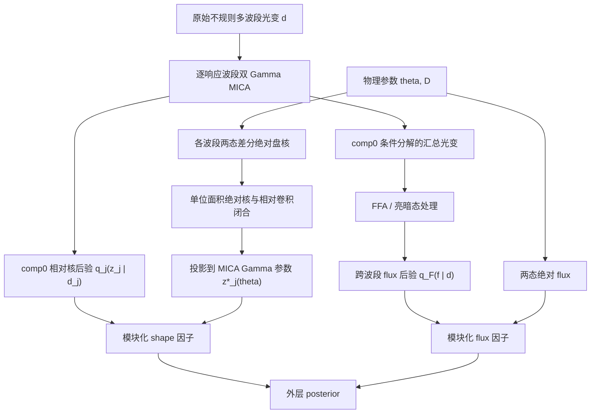

# Cackett–MICA 两态差分盘距离：贝叶斯统计建模报告

> 日期：2026-08-13  
> 状态：单源原型实现前的统计设计文档  
> 重点：两阶段贝叶斯框架、MICA 后验传播、两态绝对通量、完整相对转移函数、数值稳定性与验证标准  
> 建议首个测试源：Mrk 142；固定双 Gamma MICA，UVW2/W2 为参考波段

## 0. 执行摘要

本报告拟建立一个不显式恢复中心电离驱动 \(q(t)\) 的盘距离前向模型。数据首先经过既有 MICA 双 Gamma 分解，将短时延 comp0 暂时视为干净盘分量；随后用 Cackett 式亮—暗两态有限差分描述盘的动态响应，并同时利用：

1. MICA 对各响应波段相对于 W2 的完整转移函数后验；
2. MICA/FFA 分解后各波段盘成分的亮态、暗态绝对 flux 后验。

物理模型对每组参数 \((\theta,D)\) 同时预测：

- 各波段亮、暗态绝对 flux；
- 各波段两态差分的绝对盘核；
- 归一化后的绝对盘核形状；
- 理论绝对核之间应满足的参考波段相对卷积关系。

距离只通过绝对 flux 中的 \(D^{-2}\) 因子直接出现；完整核形状负责约束物理时间尺度、温度律和几何。这样无需先把核压缩成质心或方差，也无需得到 \(q(t)\)。

统计上必须区分两种层级：

- **严格层级模型**：需要由同一个上游模型产生的联合摘要后验
  \(q_0(s\mid d)\)，其中 \(s=(z_1,\ldots,z_J,f)\)，并以 \(q_0/\pi_0\) 回收原数据 likelihood；
- **当前可实现的原型**：现有逐波段 MICA 核后验与跨波段 FFA flux 后验没有逐样本配对关系，只能采用明确标注的 modular/composite（模块化/复合）近似。

因此，第一版原型的目标是：

> 检查模型的可识别性、后验传播方式、数值稳定性和距离恢复能力；不把外层 CDNest evidence 解释成原始多波段光变下的严格物理 Bayes factor。

第一版推荐在 MICA 自身的固定 \(k=2\) Gamma 参数空间中工作。单位面积 comp0 核由

\[
z_j=(c_j,\log w_j)
\]

无损决定，不必对数百个高度相关的 lag bins 直接计算朴素 \(\chi^2\)。完整理论核仍参与计算：它先与理论 W2 核组成卷积闭合关系，再投影成最匹配的 MICA Gamma 参数 \(z_j^*(\theta)\)，最后与 MICA 的二维加权后验密度比较。

flux 模块的第一版使用六波段联合的绝对差分通量

\[
y_\Delta=\{\log\Delta F_j\}_{j=0}^{J},
\]

而不使用当前 FFA 参数化中跨波段强制共享的单个 \(\epsilon\)。这样动态核与 flux 使用同一个亮—暗有限差分，且 \(D^{-2}\) 信息仍完整保留。

---

## 1. 研究目标、近似层级与不做的事情

### 1.1 目标参数

最终目标是单源盘距离后验

\[
p(D,\theta\mid d),
\]

其中可考虑的盘参数包括

\[
\theta=
\{T_F,\eta,b,i,R_{\rm in},R_{\rm out},\ldots\},
\qquad
\eta\equiv\log(T_B/T_F)>0.
\]

\(R_0=1\) light-day 可作为温度归一化的固定坐标约定，

\[
T_r(R)=T_r(R_0)\left(\frac{R}{R_0}\right)^{-b},
\qquad r\in\{B,F\}.
\]

第一版调试可以固定 \(b=3/4\)、固定或强约束 \(i\)，先只释放

\[
(\log T_F,\eta,\log D),
\]

确认动态与绝对幅度两个通道能够共同恢复距离；随后再逐步释放 \(b\)、\(i\) 和边界参数。

### 1.2 明确接受的物理与测量近似

1. MICA 只运行一次，不在外层采样中重新拟合原始光变。
2. 双 Gamma MICA 的短时延 comp0 暂时视为盘分量；comp1 吸收非盘慢响应。
3. W2 是观测参考波段，不是假定为真正的中心电离驱动。
4. 亮态与暗态是两个经验包络状态，不要求各波段极值出现在同一历元。
5. 盘在两态下由两个温度剖面 \(T_B(R)\) 和 \(T_F(R)\) 表示。
6. 当 \(T_B/T_F\) 接近 1 时，有限差分可近似代表该变幅范围内的平稳线性响应。
7. 离群值清理规则在查看距离结果前固定，不能为了压低 \(T_B/T_F\) 而删除极端点。

### 1.3 第一版不声称解决的问题

- 不恢复未知的真实电离驱动 \(q(t)\)；
- 不把 MICA comp0 等同于无模型误差的真实物理盘核；
- 不把当前 kernel 与 flux 两块的乘积称为严格原始光变 likelihood；
- 不在第一版使用 MICA gain，以避免与亮暗 flux 的零阶幅度信息重复计数；
- 不以第一版 CDNest evidence 比较 Gamma/Gaussian、1/2/3 component 或不同物理模型；
- 不把单次真实数据拟合成功当作覆盖率验证。

本文不重新讨论已经明确知晓的 Cackett 公式订正；实现时只要求所有 frame、单位与距离定义采用一套显式且一致的约定。

---

## 2. 信息流与统计层级

### 2.1 当前实际数据流



这里的两条上游路径不是独立实验：它们都来自相同原始光变，FFA 还使用了 MICA 分解产品。因此当前的

\[
q_0(z,f\mid d)
\approx
\left[\prod_j q_j(z_j\mid d_j)\right]q_F(f\mid d)
\]

不是由条件独立性严格推出的等式，而是原型阶段的模块化近似。

### 2.2 理想的严格数据流

严格版本应只有一个由原始数据得到的联合摘要后验：

\[
s=(z_1,\ldots,z_J,f),
\qquad
q_0(s\mid d).
\]

核参数、盘光变分解和亮暗 flux 必须在同一个上游 draw 中保持配对；各响应波段还应共享同一个 W2 潜在过程。此时原始光变只进入一次，后续才能严格回收 likelihood。

---

## 3. 符号与数据对象

| 符号 | 含义 |
|---|---|
| \(d\) | 原始不规则多波段光变及误差 |
| \(j=0\) | 参考波段 W2 |
| \(j=1,\ldots,J\) | 响应波段 M2、W1、U、B、V |
| \(r\in\{B,F\}\) | bright/faint 状态；这里的 \(B\) 是亮态标签，不是 B 滤光片 |
| \(\theta\) | 除距离外的盘温度与几何参数 |
| \(D\) | 待推断距离参数；实现中优先采样 \(\log D\) |
| \(z_j=(c_j,\log w_j)\) | 第 \(j\) 波段 MICA comp0 的单位面积 Gamma 核参数 |
| \(f\) 或 \(y_F\) | 亮暗 flux 的非冗余联合坐标；第一版取 \(y_F\equiv y_\Delta=\{\log\Delta F_j\}\) |
| \(q_j(z_j\mid d_j)\) | MICA 给出的加权后验密度 |
| \(\pi_j(z_j)\) | MICA 工作先验经过排序、选支和边缘化后的诱导先验 |
| \(q_F(y_F\mid d)\) | FFA/极值分析给出的跨波段联合后验密度 |
| \(\pi_F(y_F)\) | FFA 工作先验在相同 flux 坐标下的诱导先验 |
| \(\Sigma_{\rm disc}\) | 物理盘核到 MICA Gamma 表示之间的模型/投影误差 |
| \(\alpha,\beta\) | shape 与 flux 模块的 tempering 权重 |

---

## 4. 两态物理前向模型

### 4.1 带通黑体表面亮度

用 \(W_j(\lambda)\) 表示第 \(j\) 个滤光片的 throughput 和相应光子/能量计数约定。定义带通积分后的黑体表面亮度

\[
\mathcal B_j(T)
=
\frac{\int W_j(\lambda)B_\lambda(T)\,Q_j(\lambda)\,d\lambda}
{\int W_j(\lambda)Q_j(\lambda)\,d\lambda},
\]

其中 \(Q_j\) 记录所采用的标定权重。第一版调试可以用有效波长的单色近似，但正式结果必须将其作为模型近似检查，而不能与完整带通结果混用。

### 4.2 亮态与暗态绝对 flux

定义不含距离稀释的投影盘辐射

\[
S_{j,r}(\theta)
=
\int_{\rm disk}
\mathcal B_j[T_r(R)]\,dA_{\rm proj},
\qquad r\in\{B,F\}.
\]

观测模型写为

\[
F_{j,r}^{\rm th}(\theta,D)
=
\mathcal C_j\,D^{-2}S_{j,r}(\theta),
\]

其中 \(\mathcal C_j\) 统一承载既定的单位、bandpass 和 frame 换算。所有实现必须对 \(\mathcal C_j\) 做单独量纲测试。

差分 flux 是

\[
\Delta F_j^{\rm th}
=F_{j,B}^{\rm th}-F_{j,F}^{\rm th}
=\mathcal C_jD^{-2}\Delta S_j,
\]

\[
\Delta S_j=S_{j,B}-S_{j,F}.
\]

### 4.3 两态差分绝对盘核

定义不含距离因子的有限差分核

\[
\widehat\Phi_j^\Delta(\tau\mid\theta)
=
\int_{\rm disk}
\left\{
\mathcal B_j[T_B(R)]-
\mathcal B_j[T_F(R)]
\right\}
\delta[\tau-\tau_g(R,\phi)]\,dA_{\rm proj}.
\]

这里 \(\tau_g(R,\phi)\) 是给定盘几何下，从中心照明到盘面元再到观测者的光行时延。

其面积必须与独立计算的差分盘辐射一致：

\[
\int\widehat\Phi_j^\Delta(\tau)d\tau
=\Delta S_j.
\]

这条面积守恒是最重要的数值单元测试之一。

单位面积理论绝对核为

\[
\psi_j(\tau\mid\theta)
=
\frac{\widehat\Phi_j^\Delta(\tau\mid\theta)}
{\Delta S_j(\theta)},
\qquad
\int\psi_jd\tau=1.
\]

距离 \(D\) 在归一化时完全消掉。因此：

\[
\text{核形状通道约束物理时间尺度与几何，}
\qquad
\text{绝对 flux 通道提供 }D^{-2}.
\]

### 4.4 相对于 W2 的完整核闭合

MICA 使用 W2 作为观测 driver，故盘模型必须满足

\[
\psi_j(\tau\mid\theta)
\simeq
\left[k_{j\mid0}*\psi_0\right](\tau),
\]

而不是把 MICA comp0 直接等同于第 \(j\) 波段相对于真实中心电离源的绝对盘核。

固定 \(k=2\) 的单位面积 shifted Gamma 核为

\[
k(\tau\mid c,w)
=
\frac{\tau-c}{w^2}
\exp\left[-\frac{\tau-c}{w}\right]
H(\tau-c),
\qquad w>0.
\]

其中 \(H\) 是 Heaviside 阶跃函数。

它的面积、峰值和一阶矩分别是

\[
\int k\,d\tau=1,
\qquad
\tau_{\rm peak}=c+w,
\qquad
\mu=c+2w.
\]

MICA collector 当前按 \(c+2w\) 对双组分逐 draw 重排，comp0 是较短一阶矩的分量。\(c<0\) 对相对核并非自动非法，数值实现不得把负 lag 静默截掉。

---

## 5. 严格的两阶段贝叶斯框架

### 5.1 联合摘要 posterior 的 likelihood 回收

设上游 MICA/FFA 联合模型在摘要参数 \(s\) 上使用工作先验 \(\pi_0(s)\)，得到

\[
q_0(s\mid d)
=
\frac{\mathcal L_0(d\mid s)\pi_0(s)}{Z_0}.
\]

若物理盘模型给出归一化条件分布

\[
p_{\rm phys}(s\mid\theta,D),
\]

则严格的 summary-level 层级模型是

\[
\boxed{
p(\theta,D,s\mid d)
\propto
\pi(\theta,D)
\frac{q_0(s\mid d)}{\pi_0(s)}
p_{\rm phys}(s\mid\theta,D)
}.
\]

边缘化 \(s\) 后，

\[
\boxed{
\mathcal L_{\rm eff}(\theta,D)
=
Z_0
E_{s\sim q_0(s\mid d)}
\left[
\frac{p_{\rm phys}(s\mid\theta,D)}{\pi_0(s)}
\right]
}.
\]

这就是 posterior recycling。这里的“后验除以前验”只适用于：物理层用 \(p_{\rm phys}\) 替换上游工作先验并希望恢复原数据 likelihood 的场景。

### 5.2 固定模型时 evidence 常数的处理

若固定同一个双 Gamma、双组分 MICA 模型，只推断 \((\theta,D)\)，则 \(Z_0\) 与物理参数无关，可以从 posterior 中省略。

若要进行以下任一操作，则不能省略：

- 比较 Gamma 与 Gaussian；
- 比较不同 component 数；
- 比较条件分支；
- 报告严格的下游 evidence；
- 做跨 MICA 模型平均。

令 \(M\) 表示母 MICA 模型，\(\mathcal E\) 表示一个条件分支事件。若该分支被视为受限先验模型，其 evidence 关系为

\[
Z_{\mathcal E}
=
Z_M
\frac{P(\mathcal E\mid d,M)}{P(\mathcal E\mid M)}.
\]

只保留 conditional posterior 或只乘 posterior branch mass 都不充分。

### 5.3 确定物理预测与模型误差

如果物理模型对摘要参数给出确定预测

\[
s=g(\theta,D),
\]

形式上

\[
p_{\rm phys}(s\mid\theta,D)
=\delta[s-g(\theta,D)],
\]

于是

\[
\mathcal L_{\rm eff}
\propto
\frac{q_0(g(\theta,D)\mid d)}
{\pi_0(g(\theta,D))}.
\]

若允许物理模型、Gamma 投影或分解误差，应使用归一化密度，例如

\[
p_{\rm phys}(s\mid\theta,D)
=
\mathcal N
\left[s;g(\theta,D),\Sigma_{\rm disc}\right].
\]

\(\Sigma_{\rm disc}\) 表示物理摘要到上游参数化之间的额外映射/模型误差，而不是 MICA 测量协方差；测量不确定性已经包含在 \(q_0\) 中。端到端恢复试验只可用来估计 pseudo-true 映射的系统偏移或超出 \(q_0\) 的额外散布，不能把恢复样本的总随机散布原样再放进 \(\Sigma_{\rm disc}\)，否则会重复计算不确定度。

### 5.4 带权样本的确定性边缘化

若上游有固定的加权样本 \((s_n,\widetilde w_n)\)，其中

\[
\sum_n\widetilde w_n=1,
\]

则

\[
\log\mathcal L_{\rm eff}
=
\log Z_0+
\operatorname{logsumexp}_n
\left[
\log\widetilde w_n
+\log p_{\rm phys}(s_n\mid\theta,D)
-\log\pi_0(s_n)
\right].
\]

固定同一个 MICA/FFA 模型、只求参数 posterior 时，\(\log Z_0\) 是可省略的常数；跨上游模型比较或计算严格 evidence 时必须保留。同一次 likelihood 必须对固定样本集做确定性求和，或者显式把 \(s\) 作为外层潜变量。每次调用随机抽一个 MICA draw 会产生 stochastic likelihood，破坏 CDNest 的 level、evidence 和可重复性。

---

## 6. 当前产品为何只能支持模块化原型

### 6.1 核与 flux 没有联合 draw

当前产品具有以下结构：

1. 五个响应波段分别进行 pairwise MICA 拟合；
2. 每个波段的 `sample` 只在本波段 run 内有意义；
3. 五个 run 重复使用同一 W2 光变，但不共享同一个 W2 latent draw；
4. MICA 分解阶段留下的是条件分解曲线的汇总，而非每个 raw MICA draw 的完整 comp0 光变；
5. FFA 在这些汇总分解曲线上重新拟合，生成另一套跨波段联合 flux posterior；
6. 因而 FFA 行号不能与 MICA 行号连接。

所以现有数据不能构造真正的

\[
q_0(z_1,\ldots,z_J,f\mid d).
\]

仅用经验 covariance 也不能恢复已经丢失的非高斯联合依赖。

### 6.2 第一版模块化 posterior

第一版可以定义一个清楚但近似的 cut/composite posterior：

\[
\boxed{
p_{\rm cut}(\theta,D\mid d)
\propto
\pi(\theta,D)
\left[\widetilde{\mathcal L}_{\rm shape}(\theta)\right]^\alpha
\left[\widetilde{\mathcal L}_{F}(\theta,D)\right]^\beta
}.
\]

主分析暂取

\[
\alpha=\beta=1,
\]

并至少检查

\[
(\alpha,\beta)\in
\{(1,0),(0,1),(1,1),(1/2,1),(1,1/2)\}.
\]

这些 tempering 结果用于检查重复计数和模块冲突，不是任意调节结果的自由参数。

此时：

- MICA 只提供单位面积 kernel shape；
- FFA/极值 posterior 提供绝对 flux；
- 暂不使用 MICA `gain`；
- 不把 \(\widetilde{\mathcal L}_{\rm shape}\widetilde{\mathcal L}_F\) 的 CDNest evidence 解释成严格 Bayes factor。

### 6.3 cut propagation 与 \(q/\pi\) 的区别

若只是把 MICA posterior 当作测量不确定度并检查物理兼容性，则

\[
\widetilde{\mathcal L}_{\rm shape}(\theta)
=
\int q_j(z\mid d_j)
L_{\rm close}(\theta,z)\,dz,
\]

这里不除以 \(\pi_j\)。它是 modular pseudo-likelihood。

若要用物理条件分布替换 MICA 工作先验，才写成

\[
\mathcal L_{\rm shape}(\theta)
\propto
\int
\frac{q_j(z\mid d_j)}{\pi_j(z)}
p_{\rm phys}(z\mid\theta)\,dz.
\]

报告、代码变量名和输出必须标明使用的是哪一种解释，不能混用。

---

## 7. 推荐的第一版 shape 因子

### 7.1 为什么优先使用 MICA Gamma 参数空间

双 Gamma comp0 的单位面积形状在 MICA 模型内由

\[
z_j=(c_j,\log w_j)
\]

完全确定。使用这两个参数不会比使用 MICA lag-grid 核丢失额外信息，因为后者本来就是由这两个参数生成的。

直接在几百个 lag bins 上做 \(\chi^2\) 反而会遇到：

- bins 高度相关；
- 单位积分约束导致 covariance 精确奇异；
- 网格越细，若 covariance 处理不正确，似然权重会无意义地增大；
- 多峰后验被单一高斯核 covariance 抹平；
- 数值尾部与归一化误差被当成大量“独立数据点”。

### 7.2 由完整理论核得到 \(z_j^*(\theta)\)

对每组盘参数先计算完整的

\[
\psi_0(\tau\mid\theta),
\qquad
\psi_j(\tau\mid\theta).
\]

然后定义理论到 MICA 观测空间的投影：

\[
z_j^*(\theta)
=
\arg\min_z
\left\Vert
P_j
\left[
\psi_j-k(z)*\psi_0
\right]
\right\Vert_{\Omega_j}^2.
\]

\(P_j\) 去掉面积方向并可只保留数据实际约束的 shape modes；\(\Omega_j\) 是固定的函数空间权重。该最优化必须使用完整核，而不是仅匹配质心和方差。

同时保存投影失配统计量

\[
E_{{\rm proj},j}(\theta)
=
\left\Vert
P_j[\psi_j-k(z_j^*)*\psi_0]
\right\Vert_{\Omega_j}.
\]

若 \(E_{{\rm proj},j}\) 明显大于注入恢复中双 Gamma 测量层能产生的失配，则说明物理相对核无法由 MICA 非负响应 Gamma comp0 表示；此时不能仅凭 \(z_j^*\) 的 MICA 高后验密度宣称物理模型成立。

### 7.3 无模型误差的调试式

最简单的确定性调试式是

\[
\boxed{
\log\widetilde{\mathcal L}_{\rm shape}^{(0)}(\theta)
=
\sum_{j=1}^{J}
\log q_j[z_j^*(\theta)\mid d_j]
}.
\]

它只适合验证接口和可识别性，不适合正式 evidence。

### 7.4 含 \(z\) 空间映射误差的推荐式

定义归一化的

\[
p_{\rm disc}(z_j\mid\theta)
=
\mathcal N
\left[z_j;z_j^*(\theta),\Sigma_{{\rm disc},j}\right].
\]

模块化版本为

\[
\boxed{
\widetilde{\mathcal L}_{{\rm shape},j}(\theta)
=
\int q_j(z_j\mid d_j)
\mathcal N[z_j;z_j^*(\theta),\Sigma_{{\rm disc},j}]
\,dz_j
}.
\]

正式 prior-corrected 版本为

\[
\boxed{
\mathcal L_{{\rm shape},j}(\theta)
\propto
\int
\frac{q_j(z_j\mid d_j)}{\pi_j(z_j)}
\mathcal N[z_j;z_j^*(\theta),\Sigma_{{\rm disc},j}]
\,dz_j
}.
\]

\(\Sigma_{{\rm disc},j}\) 只描述理论模型到 MICA Gamma 参数 \(z_j\) 的额外映射误差；它不等于函数空间 projection residual，也不包含 \(q_j\) 已经表达的随机测量不确定度。端到端恢复试验应以 recovered posterior 相对于对应 pseudo-true \(z_j^*\) 的偏移来校准额外映射偏差，不能直接使用 recovered draws 的总 covariance。

\(E_{{\rm proj},j}\) 仍是独立的函数空间模型充分性检验。第一版把它作为预先标定的 veto：

\[
E_{{\rm proj},j}(\theta)
\leq E_{{\rm max},j},
\]

其中 \(E_{{\rm max},j}\) 由理论核到双 Gamma 测量层的注入试验预先确定；违反者令该物理参数点失效，而不是靠增大 \(\Sigma_{{\rm disc},j}\) 掩盖。以后若要软化该条件，应另定义并正规化 \(\mathcal L_{\rm proj}(E_{\rm proj}\mid\theta)\)，不能把它暗中并入二维 Gaussian。任何 discrepancy 都不能为了让似然“更有力”而任意设得很小。

### 7.5 等价的潜变量实现

外层也可以同时采样所有 \(z_j\)：

\[
p_{\rm cut}(\theta,D,\{z_j\}\mid d)
\propto
\pi(\theta,D)\widetilde{\mathcal L}_F
\prod_j
q_j(z_j\mid d_j)
\mathcal N[z_j;z_j^*(\theta),\Sigma_{{\rm disc},j}].
\]

这避免每步遍历 10000 个 MICA draw，但需要一个能稳定评价的加权 GMM/KDE 后验密度。对于每波段二维 \(z_j\)，这是可行的；若后验多峰，应使用保守的 GMM，而不是单一高斯。

---

## 8. 推荐的第一版 flux 因子

### 8.1 不得重复使用的量

对同一波段，

\[
\Delta F_j=F_{j,B}-F_{j,F},
\qquad
\epsilon_j=F_{j,F}/F_{j,B}
\]

都是 \(F_{j,B}\) 和 \(F_{j,F}\) 的确定函数。因此不能把

\[
(F_B,F_F,\Delta F,\epsilon)
\]

全部作为独立数据放入 likelihood。

### 8.2 一般的非冗余坐标

若各波段极值分别取得且均为正，推荐使用

\[
y_F=
\left{
\log F_{j,F},
\log\Delta F_j
\right}_{j=0}^{J}.
\]

它自然保证

\[
F_F>0,
\qquad
F_B=F_F+\Delta F>F_F.
\]

也可以使用

\[
y_F=
\left{
\log F_{j,B},
\operatorname{logit}\epsilon_j
\right},
\]

但必须完整传播其跨波段联合 posterior。

### 8.3 当前 FFA 产品的特殊约束

当前 FFA `distance_flux_posterior.txt` 中，同一个 draw 的六个波段共享同一 \(\epsilon\)。因此 12 维的逐波段 bright/faint 表示具有严格约束，普通样本 covariance 会奇异。

在 FFA 自身的参数化内，以下 7 维表示是非冗余的：

\[
y_{\rm FFA}=
\left(
\log F_{0,B},\ldots,\log F_{J,B},
\operatorname{logit}\epsilon
\right),
\]

但一般的两温度黑体盘会预测随波段改变的

\[
\epsilon_j^{\rm th}
=
\frac{F_{j,F}^{\rm th}}{F_{j,B}^{\rm th}},
\]

并不自然对应一个共同的 \(\epsilon^{\rm th}\)。因此不能把物理预测直接代入上述 7 维 FFA 坐标；那会额外强迫一个尚未写入物理模型的“所有波段共享 \(\epsilon\)”近似。

第一版改用该联合 posterior 的六维边缘投影：

\[
\boxed{
y_F\equiv y_\Delta
=
\left(
\log\Delta F_0,\ldots,\log\Delta F_J
\right)
}.
\]

对应的物理预测明确存在：

\[
\boxed{
y_{\Delta,j}^{\rm th}(\theta,D)
=
\log\!\left[
\mathcal C_jD^{-2}\Delta S_j(\theta)
\right]
}.
\]

这仍然逐行使用 FFA 的跨波段联合 draw，不把各波段拆成独立 posterior；同时避免奇异坐标，并使 flux 与 transfer-function 两块共享同一个亮—暗有限差分。它不再单独使用亮态和暗态的 DC 水平，因而牺牲了一部分状态 SED 信息，但距离所需的绝对标度仍在 \(\Delta F_j\) 中。

若以后确实要利用 \(F_{j,B}\) 与 \(F_{j,F}\) 的全部信息，需要二选一：

1. 重新生成不强制跨波段共享 \(\epsilon\) 的联合 flux posterior；或
2. 明确定义“理论 flux \(\rightarrow\) FFA 7 维流形”的投影，并把投影残差作为正规化的 discrepancy。

### 8.4 flux 模块化 likelihood

以下统一保留 \(y_F\) 记号；在第一版中它专指 \(y_\Delta\)。物理模型给出对应的

\[
y_F^{\rm th}(\theta,D).
\]

无模型误差时，

\[
\boxed{
\log\widetilde{\mathcal L}_F^{(0)}(\theta,D)
=
\log q_F[y_F^{\rm th}(\theta,D)\mid d]
}.
\]

加入标定、极值选择、FFA 分解或有限差分模型误差后，可写成

\[
\boxed{
\widetilde{\mathcal L}_F(\theta,D)
=
\int q_F(y\mid d)
\mathcal N
\left[y;y_F^{\rm th}(\theta,D),\Sigma_{F,{\rm disc}}\right]dy
}.
\]

正式 posterior recycling 则需再除以相同坐标下的 \(\pi_F(y)\)。目前 FFA 的诱导 prior 并不简单，第一版可先采用 cut 版本，但必须明确其证据不具有严格解释。

### 8.5 高斯近似下的 \(\chi^2\)

如果 \(q_F(y\mid d)\) 在所选坐标中近似多元高斯，

\[
q_F(y\mid d)
\simeq
\mathcal N(y;\widehat y_F,C_F),
\]

则

\[
-2\log\widetilde{\mathcal L}_F
=
(\widehat y_F-y_F^{\rm th})^TC_F^{-1}
(\widehat y_F-y_F^{\rm th})
+\log|C_F|+{\rm const}.
\]

这里可将等式右侧的二次型记作 \(\chi_F^2\)。它只是 posterior/likelihood 局域高斯化后的特例，不是处理任意非高斯 FFA posterior 的普遍定义。

---

## 9. MICA 工作先验与 posterior recycling 的关键问题

### 9.1 必须在相同坐标与相同测度下计算 \(q/\pi\)

MICA native 参数包含

\[
(\log A_i,c_i,\log w_i).
\]

如果在物理坐标 \((A_i,c_i,w_i)\) 中拟合 posterior 密度，则先验密度必须带相应 Jacobian：

\[
\pi(A,w)\propto\frac{1}{Aw}.
\]

不能用变换后的 \(q\) 除以变换前的 \(\pi\)。第一版若使用

\[
z=(c,\log w),
\]

可以与 MICA 的 native width 坐标保持一致，但 component ordering 仍会改变边缘先验。

### 9.2 comp0 的诱导先验不是简单矩形

两个 Gamma 分量在 MICA 中有自己的 amplitude、center 和 width。当前 collector 对每个 draw 按

\[
c+2w
\]

重新排列完整三元组 \((A,c,w)\)，再把较短一阶矩分量定义为 comp0。因此 comp0 的

\[
\pi_{\rm comp0}(c,\log w)
\]

是一个顺序统计诱导先验，不等于单个 native 分量的

\[
\operatorname{Uniform}(c)
\times
\operatorname{Uniform}(\log w).
\]

正式 \(q/\pi\) 的推荐做法是：

1. 从完整 MICA native prior 生成大量双组分 prior draws；
2. 对 \((A,c,w)\) 整组执行与 collector 完全相同的 \(c+2w\) 排序；
3. 应用相同 branch selection；
4. 边缘化不使用的 amplitude 和 nuisance 参数；
5. 在 \(z=(c,\log w)\) 空间拟合诱导 prior 密度。

`mica_prior_summary.csv` 为空不表示没有先验；实际运行边界保存在各 run 的 `data/para_names_line.txt_2` 中。

### 9.3 暂不做 prior correction 时的报告规范

如果第一版直接使用 \(q_j(z\mid d_j)\)，必须称为：

- posterior-as-measurement；
- modular/cut prototype；或
- composite pseudo-likelihood。

不得将其称为从原始光变恢复出的严格 likelihood，也不得用其 evidence 作物理模型 Bayes factor。

---

## 10. 后验表示与采样策略

### 10.1 MICA raw weighted samples

优先使用

\[
\texttt{sample1d.txt\_2 + weights.txt},
\]

或 collector 中保留原始权重的样本，而不是 `posterior_sample1d.txt_2`。后者已经由带权样本拒绝重采样为等权 posterior，包含大量重复点，再做 KDE/GMM 会扭曲密度和有效样本量。

原始 MICA 权重必须归一化：

\[
\widetilde w_n=\frac{w_n}{\sum_mw_m}.
\]

每个波段单独归一；汇总文件五个波段的总权重和为 5，而不是 1。

至少报告：

\[
N_{\rm eff,Kish}
=
\frac{1}{\sum_n\widetilde w_n^2},
\]

以及 entropy ESS。若做下游重要性回收，还要在每个外层参数点计算

\[
a_n(\theta)
\propto
\widetilde w_n
\frac{p_{\rm phys}(z_n\mid\theta)}{\pi(z_n)},
\]

\[
N_{\rm eff,imp}(\theta)
=
\frac{1}{\sum_na_n^2}.
\]

建议初始验收门槛：在高 posterior 区域

\[
N_{\rm eff,imp}\gtrsim100,
\qquad
\max_na_n<0.05.
\]

不满足时说明固定上游样本没有覆盖物理模型需要的区域；不能用平滑 GMM 人为创造支持。

### 10.2 二维 Gamma 参数 posterior

对每个波段在

\[
(c,\log w)
\]

空间拟合 weighted GMM。建议：

- 先白化特征；
- 多个初始化；
- GMM component 数保持克制；
- 用 weighted held-out log predictive density 选择复杂度；
- 对 covariance 加尺度相关的轻微正则；
- 与 weighted 1D/2D marginal、尾部概率和 posterior predictive kernel 对照。

KDE 只适合低维；当前二维 shape 可以使用，但必须检查 weighted bandwidth 灵敏度和边界变换。单一高斯会在多峰之间制造虚假的高密度区域。

### 10.3 flux posterior 密度

当前 Mrk142 FFA 只有 1122 个跨波段联合 draw。在 12 维冗余 bright/faint 坐标中直接 KDE 不可靠。推荐顺序：

1. 第一版使用前述六维 \(\{\log\Delta F_j\}\) 坐标；
2. 检查是否近似椭圆；
3. 若近似高斯，采用 full covariance 并用 shrinkage；
4. 若明显非高斯，使用低 component 数的 GMM；
5. 另行比较在原始 FFA latent 参数 \((\tau,A_j,R_j^{\rm FFA})\) 上建模的稳定性；其中 \(A_j\) 是波段 offset，\(R_j^{\rm FFA}\) 是公共潜在过程到该波段的增益，不是盘半径。

不能将跨六波段的联合 draw 拆成六个独立的 1D posterior 相乘。

### 10.4 三种计算方式

| 方式 | 用途 | 主要限制 |
|---|---|---|
| 中位核/中位 flux 的普通 \(\chi^2\) | 单元测试与调试 | 丢失非高斯后验，不得作为正式结果 |
| GMM/KDE 密度 + 显式潜变量 | 推荐第一版 | 需要密度拟合和 prior/坐标审计 |
| 固定 weighted draws 的 `logsumexp` | 最直接的确定性边缘化 | 每步遍历样本较慢，需监控 importance ESS |

---

## 11. 转移函数离散化与卷积

### 11.1 密度约定

所有 lag-grid 数组统一解释为概率密度：

\[
\sum_m\psi_m\Delta\tau=1.
\]

离散线性卷积必须写成

\[
(k*\psi)_m
=
\Delta\tau
\sum_nk_n\psi_{m-n}.
\]

漏掉 \(\Delta\tau\) 会使结果依赖 lag 分辨率；之后再归一化可能掩盖这个错误。

### 11.2 FFT 必须表示线性卷积

FFT 长度必须满足

\[
N_{\rm FFT}\geq N_k+N_\psi-1,
\]

并对两端零填充。禁止使用未填充的 circular convolution。

若两个输入网格起点分别为 \(t_{0,k}\) 和 \(t_{0,\psi}\)，输出起点是

\[
t_{0,{\rm out}}=t_{0,k}+t_{0,\psi}.
\]

必须显式追踪坐标，不得用 `fftshift` 猜测物理 lag。

### 11.3 负 lag 与 Gamma 无限尾

- 理论绝对盘核可保持因果；
- 相对 W2 核允许负 lag；
- MICA 当前 center prior 也包含负值；
- 不得裁掉负 lag 后重新归一化。

Gamma 有无限尾。lag 支持应覆盖所有相关 posterior 和理论核的高分位尾部，每次记录 captured mass。建议门槛：

\[
M_{\rm captured}>0.9999.
\]

窄 Gamma 优先使用解析 CDF 计算每个 bin 的概率质量，而不是只在 bin 中心取密度。有限网格截尾与单位面积归一化必须分开记录，不能通过无声重归一化掩盖尾部损失。

### 11.4 卷积单元测试

必须包括：

1. delta 核卷积给出严格平移；
2. direct convolution 与 FFT convolution 一致；
3. 定义 \(M_0(g)\equiv\int g(\tau)\,d\tau\)，面积满足
    \[
    M_0(k*\psi)=M_0(k)M_0(\psi);
    \]
4. 一阶矩满足
    \[
    \mu_{k*\psi}=\mu_k+\mu_\psi;
    \]
5. 负起点坐标映射正确；
6. 改变 \(\Delta\tau\) 不改变物理结果。

---

## 12. 理论盘核与 Planck 积分的数值稳定性

### 12.1 \(T_B\simeq T_F\) 时的消减误差

本项目恰好关心

\[
T_B/T_F\rightarrow1,
\]

直接计算

\[
B_\lambda(T_B)-B_\lambda(T_F)
\]

可能发生浮点消减。至少应：

- 使用 float64；
- 使用 `expm1`；
- 在安全区与直接差分对照；
- 在极小 \(\eta\) 时使用稳定的 log-ratio 差分，或以中点导数展开作数值交叉检查；
- 验证 \(\eta\to0\) 时有限差分连续趋近导数极限。

一个稳定思路是

\[
\mathcal B_j(T_B)-\mathcal B_j(T_F)
=
\mathcal B_j(T_F)\,\operatorname{expm1}
\left[
\log\mathcal B_j(T_B)-\log\mathcal B_j(T_F)
\right].
\]

### 12.2 固定网格与连续沉积

- \(R\) 使用 log grid；
- annulus 面积使用准确的边界面积或中点高阶近似；
- lag 沉积使用解析环延迟分布或 cloud-in-cell；
- 不使用 nearest-bin，以免 likelihood 随参数跳变；
- 在所有 \(\theta\) 上保持固定网格和固定边界；
- 不在 likelihood 内使用会随参数改变节点数的自适应网格。

现有 `test/disk_transfer/disktf_diff.py` 已包含有限差分核基线，但正式联合模型还需补足：绝对 flux、完整 bandpass、统一 frame 约定和高效的固定几何缓存。

### 12.3 数值展宽不能伪装成物理展宽

若为了抗混叠给每个盘面元加入矩形 pulse，会把核质心和宽度系统改变。任何纯数值平滑必须：

- 对所有理论和 MICA 核使用一致规则；或
- 明确去除其已知质心偏移；或
- 优先改用 CIC/解析 bin mass，而不额外加入非对称 pulse。

### 12.4 绝对面积与 shape 必须独立计算并交叉校验

距离信息来自

\[
\Delta S_j=\int\widehat\Phi_j^\Delta d\tau.
\]

正式实现应同时用两条路径计算：

1. 直接盘面积分得到 \(\Delta S_j\)；
2. lag-bin 核积分得到数值面积。

两者用于守恒检查。不能先把核归一化，再试图从单位面积 shape 恢复距离信息。

---

## 13. covariance、PCA 与模型误差

### 13.1 单位面积 covariance 的奇异性

单位面积核满足

\[
\Delta\tau\,\mathbf 1^T\boldsymbol\psi=1.
\]

所以 lag-bin covariance 至少有一个精确零特征方向；若有 \(N_{\rm nz}\) 个非零权重样本，其代数秩还不超过 \(N_{\rm nz}-1\)。Kish ESS 不是整数秩上界，但 ESS 很低意味着 covariance 的数值有效秩和尾部稳定性会更差。禁止直接求逆，也不应靠很大的 jitter 强行变成满秩。

若未来采用 kernel-PCA，应：

- 先投影掉面积方向；
- 使用带 \(\sqrt{\Delta\tau}\) 的函数空间内积；
- 用 weighted SVD；
- 在保留子空间 Cholesky/whiten；
- 使用 pseudo-determinant；
- 将舍弃模式的重建误差计入协方差 \(\Sigma_{\rm trunc}\)。

### 13.2 PCA 不是非高斯模型

PCA 只降维，不会自动处理多峰。若 score posterior 多峰，需要 GMM 或 branch mixture；单高斯会在两个真实 mode 之间生成虚假的概率质量。

对当前固定 \(k=2\) Gamma 原型，优先使用二维 \((c,\log w)\)，PCA 留作将来混合 Gamma/Gaussian 或非参数核的统一接口。

### 13.3 模型误差的规范化

若直接在函数空间使用

\[
\mathbf e_j=P_j[\psi_j-k(z)*\psi_0],
\]

Gaussian 因子应写全：

\[
\log L_{\rm close}
=
-\frac12
\left[
\mathbf e_j^T\Sigma_j^{-1}\mathbf e_j
+\log|\Sigma_j|
+N_j\log(2\pi)
\right].
\]

这里 \(N_j\) 是 \(P_j\) 保留的 residual 维数。若 \(\Sigma_j\) 或投影算子随 \(\theta\) 改变，\(\log|\Sigma_j|\) 不能省略。若把该因子当作严格的 \(p(z\mid\theta)\)，还必须保证它在 \(z\) 空间正规化；因此第一版更推荐先计算 \(z^*(\theta)\)，再使用显式归一化的二维 Gaussian discrepancy。

---

## 14. CDNest/MCMC 的确定性、性能与缓存

### 14.1 likelihood 必须确定

对完全相同的参数输入，重复调用 100 次必须得到机器精度一致的 log-likelihood。以下做法禁止进入 CDNest likelihood：

- 每步随机抽一个 MICA posterior draw；
- 每步重新随机拟合 KDE/GMM；
- 每步随机选择 lag grid；
- 并行线程共享可变随机状态；
- 在线性域直接求很小的 posterior-recycling 权重和。

### 14.2 推荐的数值参数化

优先采样：

\[
\log D,
\quad
\log T_F,
\quad
\eta=\log(T_B/T_F),
\quad
\cos i,
\quad
b.
\]

正定 scale 使用 log 参数；有界量使用稳定变换。\(\eta\) 的有效范围应在拟合前固定，例如

\[
0<\eta<\eta_{\max},
\]

或者以 posterior 概率检查近似有效性，而不是拟合后查看距离再删除样本。

### 14.3 可预计算内容

- bandpass 与 Planck lookup table；
- 固定 \(R,\phi,\tau\) 网格；
- 几何 delay map 或解析环投影矩阵；
- 固定 MICA posterior draws 的 Gamma 核；
- MICA 核 FFT；
- weighted GMM/KDE；
- induced-prior Monte Carlo 密度；
- 固定 PCA basis；
- 所有不依赖 \(\theta\) 的 Cholesky 因子。

\(D\) 只缩放 flux，不应触发理论 shape 核重算。

### 14.4 并行策略

- 优先并行外层 CDNest particle/chain；
- BLAS 和 FFT 内部线程设为 1，避免嵌套超卖；
- 大型只读数组共享或 memory-map；
- 缓存只读，不允许多个 worker 并发写同一文件；
- 首先 benchmark 1000 次 likelihood，再估算正式运行成本。

### 14.5 计算量预估

MICA 不进入外层循环，现有双 Gamma posterior 只读取一次。以当前 Mrk 142 数据为参照，W2 有 149 个观测点，各响应波段约 146–168 点；既有五波段双 Gamma MICA 在每波段 2 核并行时，实测 wall time 约 12–15 分钟。原型不会重复承担这部分成本。

外层每次 likelihood 的主要工作是固定网格上的盘积分、一次 W2 核 FFT、五个相对卷积和五个二维 Gamma 投影。向量化、缓存后建议把 \(10^3\) 次调用的 benchmark 作为正式采样前门槛；设计目标可暂定为每次约 1–10 ms。按此量级，\(10^5\)–\(10^6\) 次确定性 likelihood 调用约需单核数分钟至数小时。若实测达到 \(0.1\)–\(1\) s/次，说明仍存在逐 \(R,\phi,j\) 的 Python 循环、重复 FFT 或不必要的逐样本边缘化，正式采样前应先优化。

不规则 cadence 和 gap 不要求把光变插值到规则时间网格：它们已由一次性 MICA 拟合处理。下游规则网格只用于“核与核”的卷积。gap 的主要代价是加宽或多峰化 MICA posterior，而不是增加外层卷积的渐近计算量。

---

## 15. 先验、可识别性与诊断拆分

### 15.1 建议的盘参数先验顺序

第一阶段调试：

- 固定 \(b=0.75\)；
- 固定或采用较窄的外部 \(i\) prior；
- 固定足够宽的 \(R_{\rm in},R_{\rm out}\)，但检查边界质量；
- 对 \(\log T_F\) 和 \(\log D\) 使用明确有限范围；
- 对 \(\eta\) 采用预先定义的小变幅 prior。

第二阶段再逐步释放：

- \(b\in[0.5,0.75]\)；
- 倾角外部先验；
- 核/flux 模型 discrepancy；
- host、标定、消光等 nuisance。

每释放一组参数，都应比较 posterior 是否由 likelihood 而非边界决定。

### 15.2 必须分别运行的四个 posterior

1. prior only；
2. flux only：
   \[
   p\propto\pi(\theta,D)\widetilde{\mathcal L}_F;
   \]
3. shape only：
   \[
   p\propto\pi(\theta)\widetilde{\mathcal L}_{\rm shape};
   \]
4. joint modular：
   \[
   p\propto\pi\widetilde{\mathcal L}_{\rm shape}\widetilde{\mathcal L}_F.
   \]

这四组用于识别：距离究竟由哪一通道推动、两个模块是否冲突，以及 joint posterior 是否只是在两个弱约束之间被先验夹出来。

### 15.3 leave-one-band-out

逐一删除 M2、W1、U、B、V，比较

- \(D\) 中位数与区间；
- \(T_F,\eta,b\)；
- 各波段 projection error；
- shape 与 flux posterior predictive。

若单个波段使 \(D\) 移动超过约 \(0.5\sigma_D\)，必须单独分析其核族、非盘残留、bandpass 或 flux 极值问题。

---

## 16. 建议首个原型：Mrk 142

### 16.1 选择理由

Mrk 142 比 Mrk 817 更适合作为第一版统计管线的调试源：

- 五个双 Gamma comp0 后验都有 10000 个 raw weighted samples；
- conditional Kish ESS 均超过约 1000；
- 所有条件分解状态为 `ok`；
- FFA 有 1122 个跨六波段联合 posterior draws；
- 六个波段的 flux 有效率均为 1；
- 没有先把 Mrk 817 已知的 U 异常、B 低 ESS 和长尾问题混入代码验证。

Mrk 817 应作为第二个压力测试源，用来检验低 ESS、多峰和核族失配时框架是否能诚实扩大不确定度或触发失败条件。

### 16.2 Mrk 142 输入文件

| 数据 | 文件 | 规模/用途 |
|---|---|---|
| comp0 核后验 | `Mrk142/runs/mica/gamma2/2comp/result/comp0/mica_tf0_posterior.txt` | 5 band × 10000 weighted rows；字段含 `center width tau amp gain weight` |
| 双组分联合参数 | `Mrk142/runs/mica/gamma2/2comp/result/comp0/mica_component_posterior.txt` | 100000 rows；检查同一 band/sample 下两分量及排序 |
| 亮暗 flux 后验 | `Mrk142/runs/mica/gamma2/2comp/result/comp0/fflux/analysis/distance_flux_posterior.txt` | 1122 个跨六波段联合 draws |
| 原始 FFA posterior | `Mrk142/runs/mica/gamma2/2comp/result/comp0/fflux/fit/flux_flux_posterior.txt` | 1122 rows；含 \(\tau,A_j,R_j^{\rm FFA}\)，后者是波段增益 |
| 冻结配置 | `Mrk142/runs/mica/gamma2/2comp/result/comp0/fflux/run.yaml` | 本次分解与 FFA 设置快照 |
| branch 质量 | `Mrk142/runs/mica/gamma2/2comp/result/comp0/branch_summary.csv` | posterior mass、ESS、排序/交换诊断 |
| 分解质量 | `Mrk142/runs/mica/gamma2/2comp/result/comp0/decomposition_summary.csv` | 分解 draw、unique draws、status |
| flux 质量 | `Mrk142/runs/mica/gamma2/2comp/result/comp0/fflux/analysis/distance_flux_summary.csv` | 有效率和逐波段分位数 |

### 16.3 MICA shape ESS

| 波段 | conditional Kish ESS |
|---|---:|
| M2 | 3967.28 |
| W1 | 1157.02 |
| U | 3448.31 |
| B | 1045.60 |
| V | 1556.01 |

这些数值足以建立二维 weighted density 原型，但 W1、B、V 仍需检查 GMM 复杂度和尾部稳定性。

### 16.4 实际先验来源

正式 prior correction 不应只读 YAML。各波段实际应用后的 MICA 参数范围保存在

```text
Mrk142/runs/mica/gamma2/2comp/run_W2_to_<band>_2comp_gamma/
    data/para_names_line.txt_2
```

当前实际 center prior 是

\[
c\sim\operatorname{Uniform}(-10,59.795)\ {\rm day},
\]

width 在 log 坐标均匀，上下界随波段略有不同。comp0 再经过 \(c+2w\) 排序，因此必须用 prior simulation 构造最终的诱导先验。

---

## 17. 原型代码建议结构

建议新建独立目录：

```text
test/bayes_disk_distance/
    README.md
    config_mrk142.yaml
    load_mica_posterior.py
    load_flux_posterior.py
    fit_weighted_density.py
    disk_two_state_forward.py
    gamma_relative_projection.py
    likelihood_cut.py
    likelihood_recycling.py
    run_mrk142_prototype.py
    diagnostics.py
    tests/
        test_gamma_bins.py
        test_convolution.py
        test_flux_kernel_area.py
        test_deterministic_loglike.py
        test_grid_convergence.py
```

现有 `test/disk_transfer/` 中的理论核代码和 shifted Gamma 试验可以复用其经过验证的部分，但不应直接把现有绘图/单次拟合脚本当作正式 likelihood。

### 17.1 建议的中间数据合同

```text
summary_mrk142_v1.npz
metadata_mrk142_v1.json

metadata:
  source, bands, wavelengths, reference_band
  frame, time_unit, flux_unit
  mica_model, ncomp, component_order, branch_id
  source paths and SHA256/config hashes

mica/<band>:
  z_post[S,2]          # center, log_width
  weights[S]
  gain[S]              # 保存作诊断；v1 不进 likelihood
  posterior_density specification
  induced_prior_density specification, if available

flux:
  y_post[Sf,K]         # 非冗余跨波段联合坐标
  weights[Sf]
  posterior_density specification
  prior_density specification, if available
```

所有输出必须记录：源文件、选择规则、单位、frame、lag grid、bandpass 版本、随机种子、density 模型版本和代码 commit/hash。

---

## 18. 分阶段实现计划

### 阶段 A：纯数值与解析测试

1. 实现精确 shifted-\(k=2\) Gamma bin mass；
2. 实现带负起点的统一 lag grid；
3. direct 与 FFT convolution 对照；
4. 实现两态绝对 flux 与绝对核面积守恒；
5. 检查 \(T_B/T_F\to1\) 极限；
6. 做 \((N_R,N_\phi,N_\tau)\) 网格收敛；
7. 确认同一参数重复 100 次得到完全相同 logL。

### 阶段 B：无后验传播的调试基线

1. 固定 MICA posterior median \(z_j\)；
2. 固定 FFA posterior median；
3. 分别运行 flux-only、shape-only 和 joint；
4. 只用于检查参数方向、单位、卷积与 sampler 接口；
5. 不保存为科学结果。

### 阶段 C：模块化 posterior 原型

1. 对每个波段建立 weighted \(q_j(c,\log w)\)；
2. 建立跨波段 \(q_F(y_F)\)，第一版取 \(y_F=\{\log\Delta F_j\}\)；
3. 每个物理参数点计算完整理论核；
4. 将理论相对卷积投影到 \(z_j^*(\theta)\)；
5. 计算 projection GOF；
6. 用 cut density overlap 构造 shape 与 flux 因子；
7. 运行 \((\alpha,\beta)\) tempering、leave-one-band-out 和 prior sensitivity；
8. 明确不解释 evidence。

### 阶段 D：prior-corrected recycling

1. 从完整 MICA native prior 模拟双组分；
2. 执行相同排序、branch 和边缘化；
3. 构造 \(\pi_j(c,\log w)\)；
4. 研究 FFA induced prior；
5. 将 \(q\) 替换为 \(q/\pi\)；
6. 监控外层 importance ESS；
7. 仍将 kernel × flux 的因子化标记为 composite，因为当前没有联合 draw。

### 阶段 E：严格联合升级

严格升级至少需要其一：

1. 同一上游 posterior draw 同时保存各波段 kernel 参数和相应 comp0 光变/亮暗 flux；或
2. 一个共享 W2 latent process 的多响应联合 MICA；或
3. 直接构造原始光变的一阶段物理生成模型。

这不要求在外层每个参数点重新运行 MICA，但现有汇总产品本身不足以恢复已经丢失的联合依赖。

---

## 19. 验证与验收标准

### 19.1 数值收敛的初始门槛

对代表性 posterior 参数点分别加倍 \(N_R,N_\phi,N_\tau\) 并扩展 lag 支持。建议暂定：

| 项目 | 门槛 |
|---|---:|
| 核面积守恒相对误差 | \(<10^{-4}\) |
| Gamma/盘核 captured mass | \(>0.9999\) |
| 网格加倍后的 shape \(L_1\) 改变 | \(<10^{-3}\) |
| 网格加倍后的 \(D\) 中位数移动 | \(<0.1\sigma_D\) 或 \(<1\%\) |
| 区间宽度改变 | \(<5\%\)（理想为 \(<2\%\)） |
| 固定样本边缘化的数值 \(\Delta\log L\) | 后验区 \(<0.1\) |
| 关键 density/PCA/GMM 方案间 \(D\) 移动 | \(<0.2\sigma_D\)；否则列系统误差 |

### 19.2 分层注入恢复

#### Level 1：summary-level 注入

- 从已知 \((\theta_{\rm true},D_{\rm true})\) 生成理论 flux 与核；
- 加入已知的低维 posterior covariance/discrepancy；
- 检查 sampler 和 likelihood 能否恢复 truth；
- 这一级不经过 MICA，用于发现纯代码错误。

#### Level 2：MICA 参数空间注入

- 从双 Gamma prior/posterior 生成模拟 \(z\)；
- 检查 weighted density、\(q/\pi\)、排序和边缘化；
- 检查 importance ESS 和多峰覆盖。

#### Level 3：真实 cadence 的端到端注入

- 生成中心驱动、理论绝对盘核和非盘慢分量；
- 使用真实时间戳、gap 和噪声；
- 对少量模拟数据完整运行一次既有 MICA；
- 再执行相同两阶段物理拟合；
- 检查 \(D_{\rm rec}-D_{\rm true}\) 与覆盖率。

建议先做 50–100 个廉价 Level 1/2 注入，再做约 10–20 个昂贵 Level 3 注入。最终应看 SBC/rank histogram 和 68%/95% coverage，而不是只展示一次 truth 落在区间内。

### 19.3 模型失配注入

至少改变：

- comp1 非盘幅度与时延；
- U 波段额外 diffuse continuum；
- \(T_B/T_F\)；
- Gamma/Gaussian 核族；
- host/标定误差；
- lag 尾部与观测窗口；
- reference W2 自身核宽度。

这一步用于判断第一版的 \(\Sigma_{\rm disc}\) 和 tempering 是否足以覆盖实际测量算子的偏差。

---

## 20. 必须触发警告或停止的条件

出现下列任一情况，不能安静地产生距离结果：

1. 理论相对核的 Gamma projection error 超过注入恢复范围；
2. 外层 importance ESS 在 posterior 高概率区低于预设门槛；
3. posterior 大量贴住 \(D,T_F,b,i,\eta\) 的先验边界；
4. \(T_B/T_F\) 的 posterior 主要落在预设有限差分有效域之外；
5. shape-only 与 flux-only 的物理尺度 posterior 明显冲突；
6. leave-one-band-out 使 \(D\) 大幅移动；
7. grid/captured-mass 收敛失败；
8. density 模型复杂度或 bandwidth 改变使 \(D\) 移动超过容许范围；
9. MICA posterior 主要质量落在 prior 边界或 branch 选择边界；
10. 相同参数重复计算得到不同 logL；
11. 试图将当前 composite evidence 用作严格 Bayes factor；
12. 试图把不同波段相同 `sample` 编号或 MICA/FFA 行号直接连接。

---

## 21. 第一版原型的具体统计规格

为了避免第一版同时解决过多问题，建议冻结以下规格：

### 21.1 数据选择

- 源：Mrk 142；
- 参考波段：W2；
- 响应波段：M2、W1、U、B、V；
- MICA 模型：2 component Gamma；
- 盘候选：按 \(c+2w\) 排序后的 comp0；
- 使用全部 comp0 posterior mass；
- 不使用 MICA gain；
- flux 使用跨波段 FFA posterior 的六维 \(\{\log\Delta F_j\}\) 联合坐标。

### 21.2 物理模型基线

- 两态有限差分；
- \(R_0=1\) light-day；
- 首轮固定 \(b=0.75\)；
- 首轮固定 \(i\) 或使用窄外部 prior；
- \(R_{\rm in},R_{\rm out}\) 固定但做边界收敛；
- 参数：
    \[
    (\log T_F,\eta,\log D);
    \]
- \(\eta\) 范围在运行前固定。

### 21.3 likelihood 基线

\[
\log\widetilde{\mathcal L}_{\rm cut}
=
\alpha\sum_j
\log\int q_j(z)
\mathcal N[z;z_j^*(\theta),\Sigma_{{\rm disc},j}]dz
+
\beta\log\int q_F(y)
\mathcal N[y;y_F^{\rm th}(\theta,D),\Sigma_{F,{\rm disc}}]dy.
\]

先运行

\[
(\alpha,\beta)=(1,0),(0,1),(1,1),
\]

再做 tempering sensitivity。若要调试无映射误差极限，应改用第 7.3、8.4 节的确定性密度评价式；不能把任一 Gaussian covariance（\(\Sigma_{{\rm disc},j}\) 或 \(\Sigma_{F,{\rm disc}}\)）直接设为零再送入 Gaussian 计算。该 run 必须标记为 deterministic debug，而不是科学 posterior。

### 21.4 必须保存的诊断

- 每波段 weighted posterior 与 GMM/KDE 图；
- prior 与 posterior density overlap；
- \(z_j^*(\theta)\) 在 MICA posterior 中的位置；
- projection error 全 posterior 分布；
- flux posterior predictive；
- shape-only、flux-only、joint corner/summary；
- tempering 与 leave-one-band-out 表；
- grid/captured-mass 表；
- likelihood benchmark；
- 每个 run 的随机种子和输入 hash。

### 21.5 进入科学拟合前仍需冻结的选择

以下选择不阻碍先搭建数值接口，但在生成可解释的距离 posterior 前必须写入配置并冻结：

1. bright/faint 极值和离群值剔除的确定规则，以及允许的 \(T_B/T_F\) 范围；
2. 倾角采用固定值、外部 prior，还是与距离一起释放；
3. 第一版使用有效波长近似还是完整 bandpass；
4. \(\Sigma_{{\rm disc},j}\) 与 \(\Sigma_{F,{\rm disc}}\) 的初始标定来源；
5. MICA 二维 posterior 使用 weighted GMM、KDE 还是固定样本 logsumexp；
6. 何时从 cut 版本升级到 induced-prior-corrected \(q/\pi\)；
7. comp0 作为盘分量的假设何时需要由 Mrk 817 式异常或注入恢复触发模型扩展。

这些选择应由预先定义的验证标准决定，而不是在查看 \(D\) 的结果后调整。

---

## 22. 与现有理论试验的衔接

当前 `test/disk_transfer/` 已完成或部分完成：

- 两态有限差分核；
- 理论盘核的 Gamma/Gaussian 投影；
- 固定 \(k=2\) Gamma；
- 相对核卷积与理论误差诊断；
- direct shape 比较。

这些结果已经提示：非负响应 Gamma 对理论相对核的投影可能系统性低估绝对盘核的低阶尺度；因此新框架必须把

\[
E_{\rm proj}
\]

和端到端 injection–recovery 当作模型误差的一部分，而不能因为使用“完整核”就假定系统误差已经消失。完整核避免了人为只保留一两个矩，但它仍受 MICA 核族、参考波段反卷积和数据窗口的测量算子限制。

---

## 23. 参考资料

- Cackett, Horne & Winkler (2007), *Testing thermal reprocessing in AGN accretion discs*: <https://arxiv.org/abs/0706.1464>
- Li, Wang & Bai (2016), *A Non-parametric Approach to Constrain the Transfer Function in Reverberation Mapping*: <https://arxiv.org/abs/1608.03741>
- 本项目理论核基线：`test/disk_transfer/disktf_diff.py`
- 本项目固定盘生成模型：`test/disk_transfer/disk_transfer.py`
- 本项目 Gamma 相对核解析试验：`test/disk_transfer/plot_gamma_relative_transfer.py`
- Mrk 142 MICA/FFA 冻结配置：`Mrk142/runs/mica/gamma2/2comp/result/comp0/fflux/run.yaml`

---

## 24. 最终判断

该框架值得进行单源原型试验，而且计算量不是主要障碍。真正的核心是统计层级是否被诚实区分：

1. 物理层同时预测完整两态差分核与绝对 flux；
2. MICA posterior 作为分布传播，而不是固定中位核；
3. 固定双 Gamma 时在 \((c,\log w)\) 空间工作，不对大量相关 lag bins 造朴素 \(\chi^2\)；
4. 当前 kernel 与 flux 后验不联合，所以第一版只做明确标注的 modular/composite 原型；
5. \(q/\pi\) 需要正确的诱导先验、坐标与 Jacobian；
6. CDNest likelihood 必须确定、正规化并在 log 域计算；
7. 数值误差必须远小于统计误差；
8. 距离结果必须通过分层注入恢复和 coverage，而不只靠一次真实源拟合。

首个原型应以 Mrk 142 为低病态测试，确认框架后再用 Mrk 817 检验 U 波段异常、低 ESS、长尾和核族失配下的稳健性。

## 写作笔记

- 讨论两阶段贝叶斯分析时，应始终区分“上游 posterior”“由 posterior 回收的 likelihood”和“模块化兼容性因子”；自检问题是：这一项是否已经包含上游 prior？
- 所谓“使用完整转移函数”应指完整函数进入前向投影，而不必把数百个相关网格点当成独立观测；自检问题是：采用的低维表示是否对上游核族无损？
- 统计报告应把“当前产品能做到什么”和“严格模型需要什么”分开；自检问题是：是否存在未保存的联合关系，却在下游被默认成独立？
